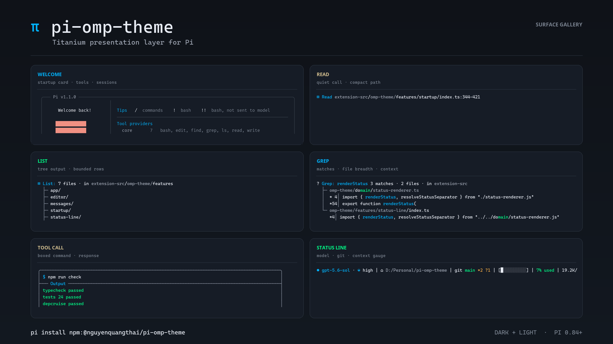
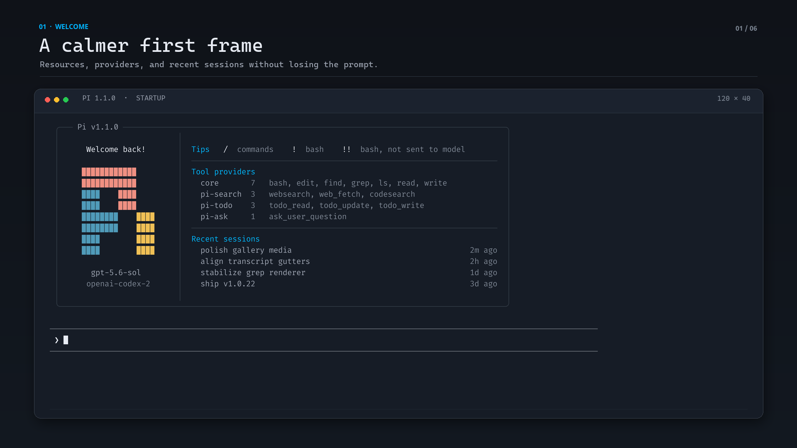
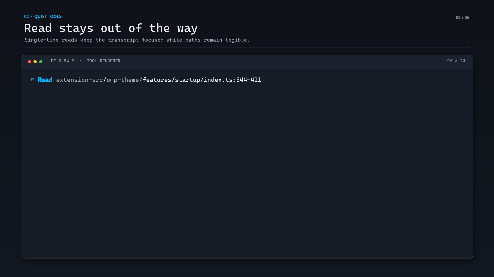
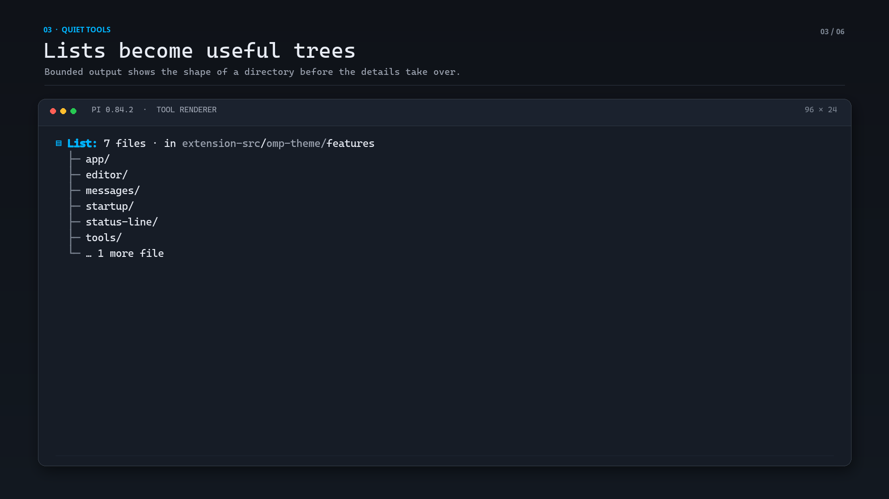
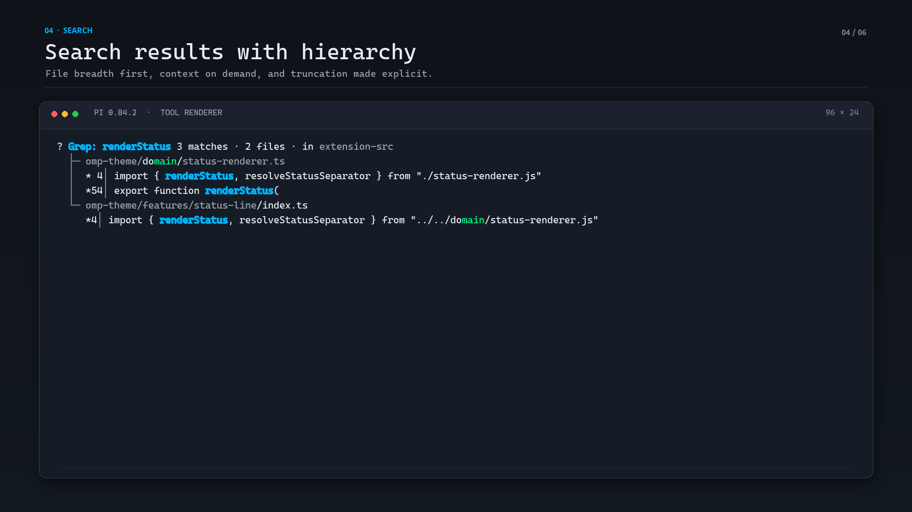
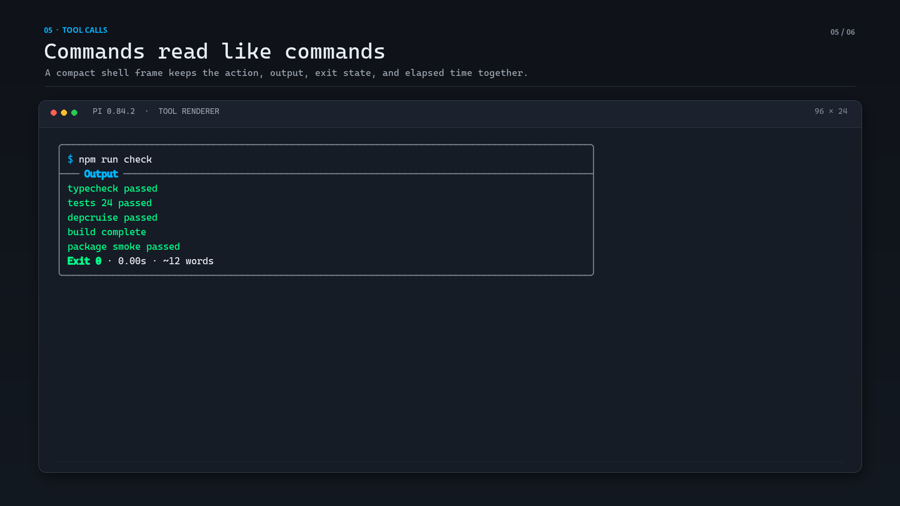
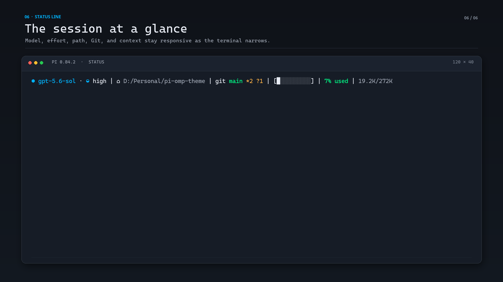

# pi-theme-collection

[](https://github.com/gnoul4869/pi-theme-collection/actions/workflows/verify.yml)
[](LICENSE)

A set of theme presets for [Pi](https://pi.dev). Each one changes how the composer, the status line, the startup view, the messages, and the tool output look.

Colours still come from Pi's own theme settings. A preset only changes the layout, so it pairs with whatever you choose in `/settings → Theme`.

`theme.autoApply` is off by default, so nothing here overwrites your theme. Switch presets for layout, switch themes for colour, and the surfaces follow straight away.

Install it with one command:

```bash
pi install git:github.com/gnoul4869/pi-theme-collection
```

Refresh it later with `pi update git:github.com/gnoul4869/pi-theme-collection` (or `pi update --extensions`).

## The collection

Nine presets, each a whole appearance: composer, status line, startup view, message and tool rendering. Switch with `/pi-theme-collection preset <name>`.

| Preset | Composer | Status line | Startup | |
|---|---|---|---|---|
| **`claude`** *(shipped)* | docked, full-width rules, no side borders | own row below the editor: model + effort, path, git, context | compact header | |
| **`claude-code`** | as `claude` | as `claude` | compact header | adds the transcript: `●` calls, `⎿` result gutter, one-line thinking, edit sentences, working row with time and tokens |
| **`omp`** | docked in a rounded box | carried on the box's top border; the context gauge fills the remaining span, the session title closes it | compact header | |
| **`default`** | docked, rounded box | powerline row: path, git, context bar, cost, model + effort | compact header | the baseline the other presets vary from |
| **`compact`** | compact, auto frame | model, thinking, git + extension statuses / context % | compact header | |
| **`full`** | boxed, outline frame, metadata shown | host, model, thinking, path, git, session / tokens, cost, %, time | overlay with resources | |
| **`minimal`** | native | path, git / context % | off | message and tool rendering off, no terminal background sync |
| **`native`** | native | model, path / context % | off | closest to plain Pi: also off are auto-apply and shimmer |
| **`ascii`** | compact, auto frame | as `default` | compact header | no Nerd Font glyphs, no terminal background sync |

### Presets × your Pi theme

The preset is structure, the theme in `/settings → Theme` is colour. Every colour the surfaces draw — status segments, composer border, tool boxes, diffs, accents — is read from the live Pi theme, so a preset sits equally well on the bundled Titanium themes, on a Pi built-in theme, or on a JSON theme of your own:

```json
{
  "piThemeCollection": {
    "preset": "omp",
    "theme": { "autoApply": "off" }
  }
}
```

Nothing is forced at session start. Switching themes recolours the active preset straight away, and the choice holds across restarts — see [docs/theme-switching.md](docs/theme-switching.md).

### Shared surfaces

Every preset draws through the same surfaces and the same configuration namespace:

- Editor and status compositions in Claude and OMP flavours, plus the neutral presets above.
- The bundled `titanium` / `titanium-light` themes (`themes/titanium.json`, `themes/titanium-light.json`) are registered with Pi's theme picker as palette options any preset can sit on.
- Responsive status segments for model, effort, path, Git, context, usage, cost, time, and session state.
- Narrow terminals collapse the project path first: leading folders drop one at a time (`📁 D:\Google Drive\Projects\Python\proj` → `📁 …\Python\proj` → `📁 proj`) before any other segment compacts or moves to the second row.
- Compact startup header or optional welcome card.
- Boxed tool rendering, quiet-call batching, adaptive diffs, elapsed time, and completed-turn summaries.
- Optional Claude Code transcript (`claude-code` preset): `● Tool(args)` calls with a `⎿` result gutter, marked answers, one-line thinking, edit sentences, an interrupt prompt, and a working row with run time and tokens.
- Optional message/tool compatibility patches with per-surface identity checks and native fallback.
- Glyph and colour handling — Nerd Font/Unicode/ASCII modes, shimmer, syntax-highlight caching, and session accents — applies to whichever theme is active.

## Requirements

- Node.js 22.19 or newer.
- Pi 0.83.x or newer. Compatibility patches are probed against the live Pi runtime per surface; Pi version numbers are diagnostic only, so unrelated releases keep the themed TUI when the patched method contracts remain unchanged. Unrecognized contracts fall back to Pi's native rendering.

## Install

Use Pi's package manager so the extension and themes are registered correctly:

```bash
pi install git:github.com/gnoul4869/pi-theme-collection
```

Running `npm install` alone downloads the package but does not register it with Pi.

This repository commits the built extension bundle, so there is **no build step** — Pi loads `dist/extensions/pi-theme-collection.ts` directly through jiti.

### Verify installation

```bash
pi list
pi -p "/pi-theme-collection doctor"
```

`pi list` should include `git:github.com/gnoul4869/pi-theme-collection`. The doctor summary reports the active preset, Pi compatibility identity, surface fallbacks, and host binding; `Host binding` should read `bound`. Use `/pi-theme-collection doctor json` when you need the complete field-level payload.

### Install from a local checkout

```bash
git clone https://github.com/gnoul4869/pi-theme-collection.git
cd pi-theme-collection
npm run check                  # bundle integrity checks + syntax check
pi install <path-to-checkout>
```

The compiled entry is `dist/extensions/pi-theme-collection.ts` on purpose. Pi loads extensions through jiti, which applies the host aliases (`@earendil-works/*` → the running Pi's own modules) while loading the `.ts` entry. A `.js` entry next to a checkout's `node_modules/@earendil-works/pi-coding-agent` can bind the extension to a second copy of Pi and make message/tool decoration silently miss the TUI. Pi 0.84.3+ runs its Node CLI/RPC entrypoints from a bundled runtime and exposes those host modules virtually; the package detects that loader path instead of comparing it with the modular package entry. If the doctor ever reports `hostBinding.status: "foreign"`, the extension was loaded outside Pi's loader; reinstall with `pi install git:github.com/gnoul4869/pi-theme-collection`.

```bash
# Project scripts (no build toolchain needed)
npm run verify        # assert the recorded fixes are present + bundle syntax
npm run test          # theme-switch checks against the real Pi theme module
npm run testWidgets   # mount the status-line widget and prove it repaints on theme change
npm run testShrink    # render the status bar while the terminal narrows, path must shrink first
npm run testEditor    # render the editor frame across presets, widths and host-written properties
npm run check         # verify + test + testWidgets + testShrink + testEditor
```

The first launch after a rebuild transpiles the bundle once (a few seconds); jiti caches the result for later launches.

### Update

```bash
pi update git:github.com/gnoul4869/pi-theme-collection
# Or update every installed Pi package:
pi update --extensions
```

### Uninstall

```bash
pi remove git:github.com/gnoul4869/pi-theme-collection
```

## Defaults

The shipped configuration uses the `claude` preset with a dock editor, a status row below the editor, compact startup presentation, boxed tools, and completed-turn summaries. Core compatibility patches remain disabled unless explicitly enabled.

**`theme.autoApply` defaults to `"off"`**, so the theme stored in Pi's settings is respected and never rewritten by this extension. Force a theme anyway with:

```json
{
  "piThemeCollection": {
    "theme": { "autoApply": "titanium" }
  }
}
```

or the `PI_THEME_COLLECTION_THEME` environment variable.

## Preset details

### Claude Code transcript

The `claude-code` preset keeps the `claude` composer and status row and renders the transcript the way Claude Code does:

```text
● The expiry check compared with < instead of <=.

● Thought for 6.2s · Ctrl+T to show

● Bash(npm test -- auth)
  ⎿  … +18 earlier lines · Ctrl+O to expand
     ✕ rejects expired tokens (12 ms)
     ✘ Exit 1 · 2.2s · ~41 words

● Edit(src/auth.ts)
  ⎿  Updated src/auth.ts with 1 addition and 1 removal
     +1 −1 · 0.2s
     -  42  if (exp < now) return true;
     +  42  if (exp <= now) return true;

● Read 1 file, ran 2 shell commands · 6.7s · Ctrl+O to expand

⣾ Working... (14s · ↓ 1.2k tokens · Escape to interrupt)
```

```json
{
  "piThemeCollection": {
    "preset": "claude-code"
  }
}
```

Each part is an ordinary option, so it can also be enabled on its own:

| Option | Effect |
|---|---|
| `tools.chrome: "inline"` | Tool calls render as `● Name(args)` with a `⎿` result gutter instead of a frame. The marker colour shows the status (running, done, failed); todo lists render as a checklist. |
| `messages.assistantMarker: true` | Each assistant answer starts with `●`, its lines hanging under it. Your messages start with the prompt's `❯` (or your `theme.glyphs.prompt`): their band starts under the `●`, covers only the text rows, and their text lines up with the answers. Replaces the `messages.assistantPrefix` gutter. |
| `messages.thinkingSummary: true` | Hidden thinking reads `● Thinking…` while it streams and `● Thought for 6s` afterwards; click it or press the thinking toggle to show it. Restored sessions show `● Thought`. |
| `theme.workingElapsed: true` | The working row shows the run time: `Working... (14s · Escape to interrupt)`. |
| `theme.workingTokens: true` | The working row shows the run's output tokens: `(14s · ↓ 1.2k tokens · Escape to interrupt)`. Streamed text counts at about four characters a token until each message reports its real usage. |
| `tools.editSummary: true` | File changes read like Claude Code's: an inline edit opens with `Updated src/auth.ts with 1 addition and 1 removal` above the `+1 −1 · 0.2s` row and the diff, and a write reads `Wrote 3 lines to notes/todo.txt · 0.2s`. On a row too narrow for it, the sentence shortens to `Updated src/auth.ts` and the write drops its path, so nothing shown before is cut. |
| `messages.interruptHint: true` | An interrupted turn keeps Pi's notice and adds `· What should the agent do instead?`: `Operation aborted · …` when Esc stops an answer, `Error: This operation was aborted · …` when it stops a tool run. Esc while a tool call's arguments are still streaming shows on that tool block, unchanged. |

The preset also lowers `tools.maxCollapsedLines` to 4. Glyphs follow the Nerd Font/Unicode/ASCII mode and can be overridden through `theme.glyphs` (`toolMarker`, `resultGutter`, `todoDone`, `todoOpen`, `thinkingMarker`); ASCII mode uses `*`, `|`, `[x]`, `[ ]`, and `~`. Message blocks (compaction, skills, branches) and user `!commands` follow the same `●`/`⎿` form, todo lists render as checklists and stay visible after a turn collapses, and the `git`/`gh` cards and `git diff`/`gh run` views hang under the gutter without frames. `grep`, `rg`, `ls`, and `find` run through bash read like the Grep, List, and Find tools (`● Grep(row in src)`).

### Hiding extension widgets

`widgets.hide` keeps chosen extension widgets off screen. The extension keeps running; only its widget is not drawn. For example, the transcript already shows pi-todo's checklist, so its pinned **Updated Plan** box above the editor can go:

```json
{
  "piThemeCollection": {
    "widgets": { "hide": ["pi-todo"] },
    "compatibility": { "allowCorePatches": true }
  }
}
```

The value is a list of widget keys (pi-todo uses `pi-todo`); other widgets are untouched, and the list is empty by default. It is a core patch, so it needs `compatibility.allowCorePatches`, and `/pi-theme-collection doctor` reports it as **Widgets**. `/todos` still shows the list. Changes to the list take effect on `/reload` or when Pi restarts.

## Configuration

Use the `piThemeCollection` key in Pi's global or trusted project `settings.json`:

```json
{
  "piThemeCollection": {
    "preset": "claude", // claude-code | omp
    "theme": {
      "autoApply": "titanium" // optional: force a theme; omit to keep Pi's /settings theme
    },
    "compatibility": {
      "allowCorePatches": false
    }
  }
}
```

Presets coordinate status placement, editor style/frame, separator, and status layout. Keep those fields omitted when you want the preset's complete composition; for example, changing only `preset` to `"omp"` selects the rounded border layout. Explicit values still win, but `/pi-theme-collection doctor` warns when they contradict coordinated preset fields and produce a hybrid UI.

Precedence:

```text
defaults < global settings < trusted project settings < environment < session override
```

Invalid values fall back safely and appear in `/pi-theme-collection doctor`.

### Read-only tool activation

By default, the theme leaves Pi's active tool set unchanged. This prevents it from
re-enabling tools intentionally disabled by extensions such as `pi-hashline-edit-pro`.
Package order is not a workaround you need with this default.

To explicitly add registered `grep`, `find`, and `ls` tools at session start:

```json
{
  "piThemeCollection": {
    "readonlyTools": true
  }
}
```

Set `readonlyTools` to `false` (the default) to leave tool selection alone. Global
and trusted-project settings follow the normal configuration precedence. A disabled
extension (`enabled: false` or `PI_THEME_COLLECTION_DISABLED=1`) never activates tools.

For one invocation, override the setting with an explicit CLI value:

```bash
pi --pi-theme-collection-readonly-tools=true
pi --pi-theme-collection-readonly-tools=false
```

The space-separated forms (`--pi-theme-collection-readonly-tools true` / `false`) also work.
**The flag requires a value;** a bare flag is not supported. A value-taking flag avoids
Pi 0.99.1 interpreting `=false` as boolean `true`. Invalid values disable activation and
emit a warning.

Activation is checked at session start, including a new session or Pi's `/reload`.
Editing settings or running `/pi-theme-collection reload` does not change active tools
mid-session. Opting out never removes tools already enabled by you or another
extension. Explicit opt-in can still re-enable a tool another extension disabled;
leave it off when using replacement tools. Pi's `--exclude-tools grep` is also
available when you need to keep native `grep` inactive while allowing `find` and `ls`.

### Environment variables

| Variable | Purpose |
|---|---|
| `PI_THEME_COLLECTION_DISABLED=1` | Disable the extension. |
| `PI_THEME_COLLECTION_NERD_FONTS=1\|0` | Force Nerd Font or non-Nerd glyphs. |
| `PI_THEME_COLLECTION_EDITOR=native\|compact\|boxed\|dock` | Override editor style. |
| `PI_THEME_COLLECTION_STATUS=above\|below\|off` | Override status placement/state. |
| `PI_THEME_COLLECTION_THEME=<name\|off>` | Select or disable automatic theme application. |
| `PI_THEME_COLLECTION_OSC11=1\|0` | Override terminal background synchronization. |
| `PI_THEME_COLLECTION_DEBUG=1` | Enable bounded diagnostics. |

### CLI flags

```text
--pi-theme-collection-core-patches
--pi-theme-collection-message-assistant
--pi-theme-collection-message-special-blocks
--pi-theme-collection-tools
--pi-theme-collection-readonly-tools <true|false>
--pi-theme-collection-ascii
```

### Commands

| Command | Purpose |
|---|---|
| `/pi-theme-collection` | Show active preset and surface state. |
| `/pi-theme-collection on\|off` | Toggle the extension for the current session. |
| `/pi-theme-collection preset <name>` | Apply a preset. |
| `/pi-theme-collection placement above\|below\|border` | Change status placement. |
| `/pi-theme-collection editor <style> [frame]` | Change editor presentation. |
| `/pi-theme-collection startup off\|compact\|overlay` | Change startup presentation. |
| `/pi-theme-collection surface <name> on\|off` | Toggle a surface. |
| `/pi-theme-collection set <path> <JSON>` | Set a validated configuration leaf. |
| `/pi-theme-collection persist global\|project set <path> <JSON>` | Persist a validated setting. |
| `/pi-theme-collection reload` | Reload configuration and affected surfaces. |
| `/pi-theme-collection doctor` | Show a compact, human-readable health report. |
| `/pi-theme-collection doctor json` | Show the complete machine-readable diagnostic payload. |

## Privacy and security

Pi extensions execute with the user's system permissions. Review the source before installation.

The extension does not implement telemetry. The optional welcome presentation reads bounded local Pi metadata; its recent-session list can derive a short display title from the opening request in local session files. That data is rendered locally and is not transmitted by this package.

## Development

```bash
npm run verify          # assert the recorded fixes are present + bundle syntax
npm run test            # theme-switch checks against the real Pi theme module
npm run testWidgets     # mount the status-line widget and prove it repaints on theme change
npm run testShrink      # render the status bar while the terminal narrows, path must shrink first
npm run testEditor      # render the editor frame across presets, widths and host-written properties
npm run check           # verify + test + testWidgets + testShrink + testEditor
```

The extension entry is `dist/extensions/pi-theme-collection.ts` on purpose: Pi loads extensions through jiti, which binds the host aliases to the running Pi instance. A compiled `.js` entry next to a checkout's own copy of Pi can bind the extension to a second Pi instance and silently miss the TUI.

Theme switching is documented in [docs/theme-switching.md](docs/theme-switching.md). The bundle is the source of truth: edit `dist/extensions/pi-theme-collection.ts` directly, then run `npm run check`.

## Foundation: pi-omp-theme

[`pi-omp-theme`](https://github.com/QuangThai/pi-omp-theme) by Nguyen Quang Thai is an
OMP-inspired presentation extension for Pi: Titanium dark/light themes with a coordinated
startup view, status line, editor, messages, and tool rendering. It is published as
`@nguyenquangthai/pi-omp-theme` under the MIT licence. This package grew out of it, and the
two are separate projects: install this one for the preset collection, install that one for
the original extension.

**What it contributes here**

- The `omp` and `claude` presets, in the shape they ship.
- The `titanium` and `titanium-light` themes in `themes/`.
- The surfaces those presets draw: status segments, composer frames, the startup header, tool
  boxes, and diffs.

**What this repository adds**

- The rest of the preset collection — `claude-code`, `default`, `compact`, `full`, `minimal`,
  `native`, `ascii` — and any preset mixed with whatever theme you pick in `/settings → Theme`.
- `/settings → Theme` respected and repainted live, documented in
  [docs/theme-switching.md](docs/theme-switching.md).
- A status bar that gives way on the project path first as the terminal narrows.
- An editor render path that survives properties the host writes onto the editor instance.
- A check suite asserting each of those, run in CI on every push.

The captures below are pi-omp-theme's own, taken in a real Pi session (Pi 0.84.2, Titanium
dark theme, Unicode glyphs, a 120-column terminal, sample local project data). They are
vendored under `media/` so this page renders on its own. Click any thumbnail for the full-size
image.



| Surface | What it demonstrates | Full-size preview |
|---|---|---|
| **Welcome** | Startup resources, tool providers, and recent sessions | [open `welcome.png`](https://raw.githubusercontent.com/gnoul4869/pi-theme-collection/main/media/welcome.png?v=gallery-5) |
| **Read** | Quiet, single-line file reads with a readable path | [open `read.png`](https://raw.githubusercontent.com/gnoul4869/pi-theme-collection/main/media/read.png) |
| **List** | Bounded directory output rendered as a tree | [open `list.png`](https://raw.githubusercontent.com/gnoul4869/pi-theme-collection/main/media/list.png) |
| **Grep** | Match counts, file grouping, context, and truncation | [open `grep.png`](https://raw.githubusercontent.com/gnoul4869/pi-theme-collection/main/media/grep.png) |
| **Tool call** | Boxed command, response, exit status, and elapsed time | [open `tool-call.png`](https://raw.githubusercontent.com/gnoul4869/pi-theme-collection/main/media/tool-call.png) |
| **Status line** | Model, effort, path, Git state, and context usage | [open `status-line.png`](https://raw.githubusercontent.com/gnoul4869/pi-theme-collection/main/media/status-line.png) |

<table>
  <tr>
    <td width="50%"><strong>Welcome</strong><br><a href="https://raw.githubusercontent.com/gnoul4869/pi-theme-collection/main/media/welcome.png?v=gallery-5"></a></td>
    <td width="50%"><strong>Read</strong><br><a href="https://raw.githubusercontent.com/gnoul4869/pi-theme-collection/main/media/read.png"></a></td>
  </tr>
  <tr>
    <td><strong>List</strong><br><a href="https://raw.githubusercontent.com/gnoul4869/pi-theme-collection/main/media/list.png"></a></td>
    <td><strong>Grep</strong><br><a href="https://raw.githubusercontent.com/gnoul4869/pi-theme-collection/main/media/grep.png"></a></td>
  </tr>
  <tr>
    <td><strong>Tool call</strong><br><a href="https://raw.githubusercontent.com/gnoul4869/pi-theme-collection/main/media/tool-call.png"></a></td>
    <td><strong>Status line</strong><br><a href="https://raw.githubusercontent.com/gnoul4869/pi-theme-collection/main/media/status-line.png"></a></td>
  </tr>
</table>

## License

[MIT](LICENSE). Required notices from the MIT-licensed sources this package builds on are
retained in `LICENSE`; the collection layout, the fixes, the tests and the docs are maintained
here.

The captures under `media/` are pi-omp-theme's, kept here under its MIT licence.
